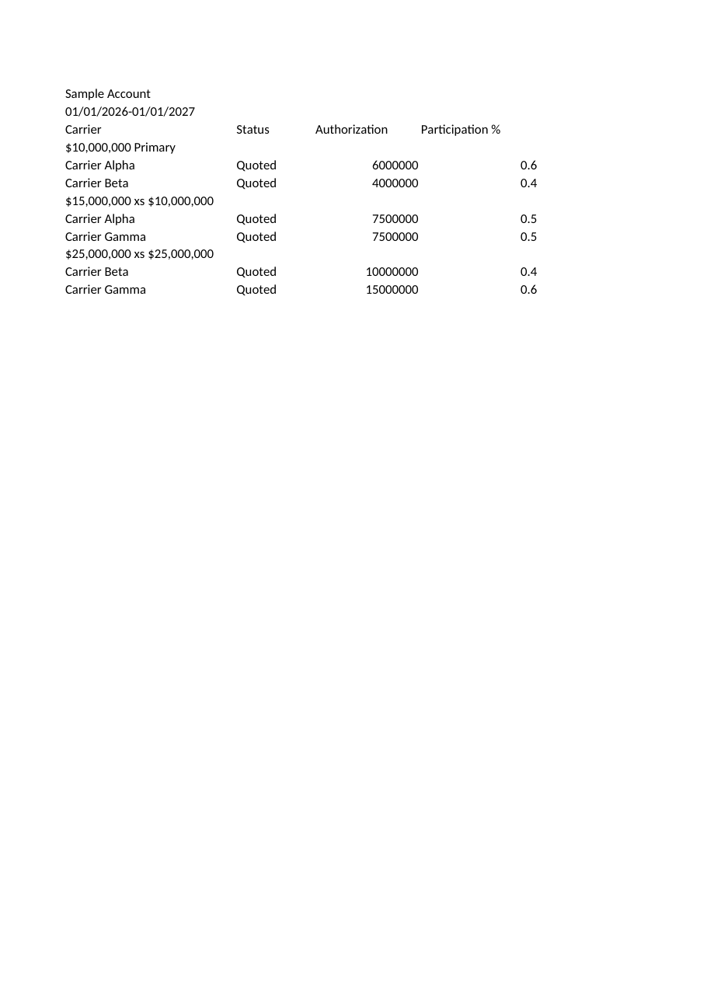
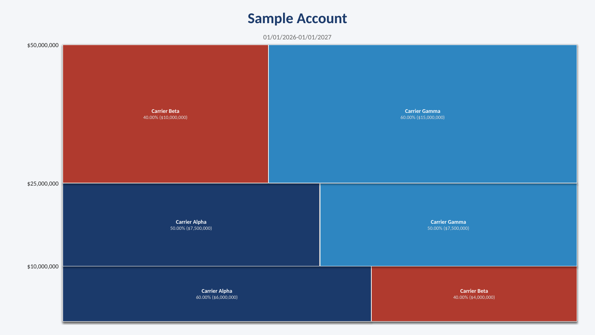
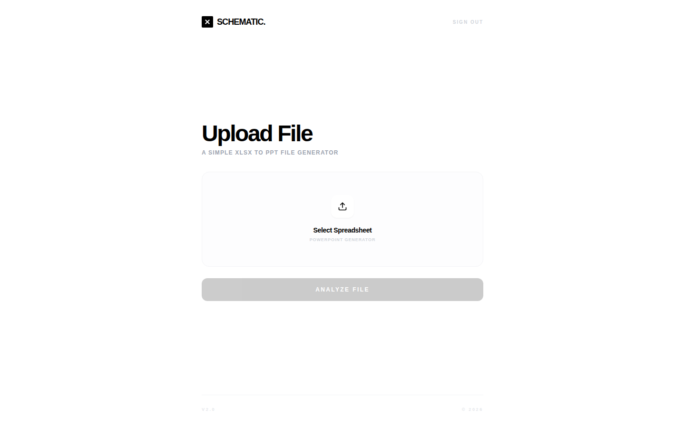
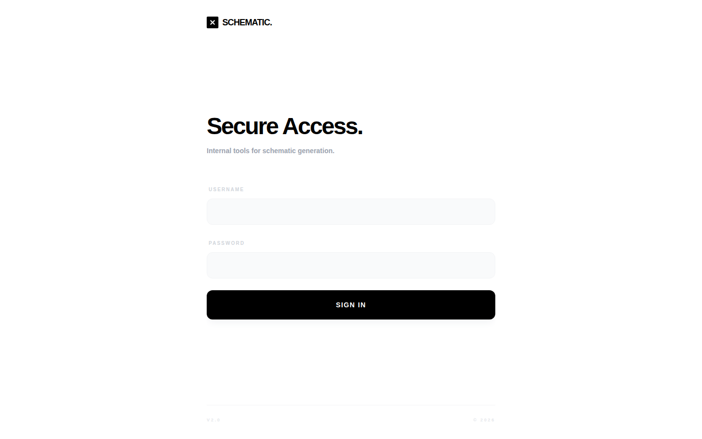
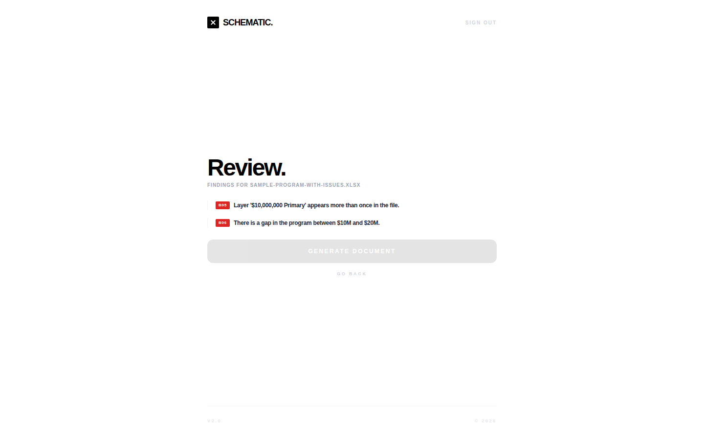
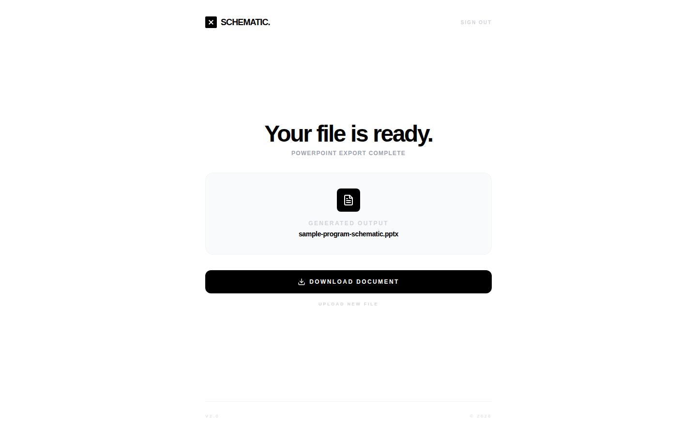

# Insurance schematic builder

A web app that turns an insurance program spreadsheet into a layered PowerPoint schematic.

Live demo: https://shematic.onrender.com

## Screenshots

<table>
  <tr>
    <td></td>
    <td></td>
  </tr>
  <tr>
    <td>Fictional workbook used as input.</td>
    <td>Slide generated from the clean sample.</td>
  </tr>
</table>


Upload a workbook and analyze it for program issues.


Sign in with the shared username and password.


Blocking flags from `docs/sample/sample-program-with-issues.xlsx`.


The generated deck is ready to download.

## My role

Improved the Python conversion engine, added auth, built the frontend, made it privacy focused, deployed it on Render.

Client project, shared with permission.

## What it does

- Reads the active worksheet of an `.xlsx` workbook and detects the account name, policy period, carrier table columns, layer labels, carriers, authorization amounts and participation percentages (`scripts/generate_schematic.py`).
- Checks the parsed program for missing layers or carriers, invalid bounds, duplicate layer labels, gaps, under- and over-subscribed layers, a missing account name, similar carrier names, large programs and TBD carriers (`scripts/validate.py`).
- Shows blocking flags and warnings in the browser and accepts a schematic title and yes/no answers for carrier-name merges (`frontend/src/components/ValidationScreen.tsx`).
- Generates a single 13.3 x 7.5 inch presentation slide with layer bands sized by dollar limits, carrier blocks, a dollar y-axis and labels (`scripts/generate_schematic.py`).
- Requires a shared username and password, returns a bearer token and expires sessions after `SESSION_TTL_SECONDS` (`backend/main.py`).
- Writes uploads to a temp directory; validation copies are deleted immediately, session copies are deleted after generation, and stale sessions are expired on later requests. A restart does not delete session files already in the temp directory. The generated deck is streamed from memory (`backend/main.py`).
- Serves the built frontend from FastAPI when `frontend/dist` exists (`backend/main.py`, `Dockerfile`).

## How it works

```text
Parse     scripts/generate_schematic.py  parse_excel, detect_columns, parse_layer_bounds
Validate  scripts/validate.py            validate; gated by scripts/run_pipeline.py
Render    scripts/generate_schematic.py  build_schematic, using python-pptx
Serve     backend/main.py                /api/login, /api/validate, /api/generate, frontend/dist
```

The API wrapper runs the same pipeline: upload, validate, then render only when validation is not blocked (`backend/main.py`).

## Stack

| Layer | Technology |
|-------|------------|
| Frontend | React 18, TypeScript, Vite, Tailwind CSS |
| API | FastAPI, Uvicorn, Pydantic |
| Conversion | Python, openpyxl, python-pptx |
| Auth | One shared credential, in-memory bearer tokens |
| Container | Multi-stage Dockerfile: Node 18 build, Python 3.11 runtime |

## Run locally

Tested with Python 3.14 and Node 24 on Linux. The commands use the default ports.

```bash
python3 -m venv .venv
source .venv/bin/activate
pip install -r requirements-dev.txt
cp .env.example .env
set -a; . ./.env; set +a
python backend/main.py
```

The API starts at `http://localhost:8000`. The app does not load `.env` by itself; the `set -a` line exports the values for this shell.

In a second terminal:

```bash
cd frontend
npm ci
npm run dev
```

The UI starts at `http://localhost:5173` and proxies `/api` to port 8000.

To try it with the sample data (all names and amounts are fictional):

1. Sign in with `ADMIN_USERNAME` and `ADMIN_PASSWORD` from `.env`.
2. Upload `docs/sample/sample-program.xlsx`, click Analyze File, then Generate Document.
3. Upload `docs/sample/sample-program-with-issues.xlsx` to see the blocking B05 and B06 flags.
4. `docs/sample/sample-output.pptx` is the deck generated from the clean sample.

Run the tests:

```bash
python -m unittest discover -s tests -v
```

The suite has 9 tests: auth helpers, carrier merges, three pipeline validation paths and the CLI output file.

## Configuration

| Variable | Purpose | Required |
|----------|---------|----------|
| `ADMIN_USERNAME` | Username for the shared login. | Optional; default `admin`. |
| `ADMIN_PASSWORD` | Password for the shared login. | Optional; default `admin123`. Set it before deploying. |
| `ALLOWED_ORIGINS` | Comma-separated origins allowed by CORS. | Optional; default `http://localhost:5173,http://127.0.0.1:5173`. |
| `SESSION_TTL_SECONDS` | Bearer-token lifetime in seconds. | Optional; default `28800`. |
| `UPLOAD_TTL_SECONDS` | Upload retention in seconds. | Optional; default `1800`. |
| `VITE_API_BASE_URL` | Absolute API base URL for the frontend build. | Optional; leave unset to use `/api` on the same origin. |

## Deploy

Live demo: https://shematic.onrender.com

The repository includes a multi-stage `Dockerfile`. The first stage builds the frontend with Node 18; the second runs Uvicorn on `backend.main:app` at port 8000 with Python 3.11 and serves the built frontend. No platform-specific `render.yaml` is included, so environment variables are supplied by the hosting environment.

```bash
docker build -t schematic .
docker run -p 8000:8000 \
  -e ADMIN_USERNAME=admin \
  -e ADMIN_PASSWORD=change-this-password \
  schematic
```

## Status and limits

- The automated suite covers auth helpers, carrier merges, three pipeline validation paths and the CLI output file. `tests/verify_formatting.py` is a separate manual render script, and there are no browser tests.
- The parser reads only the active worksheet.
- W05 is defined in `scripts/validate.py` but does not surface through `run_pipeline`: carriers with an authorization amount and zero participation are filtered out before validation.
- Sessions and uploads are held in process memory; a restart clears them. A restart does not delete session files already written to the temp directory, and there is no startup sweep.

## Author

Tan Farhan, freelance full-stack developer.
